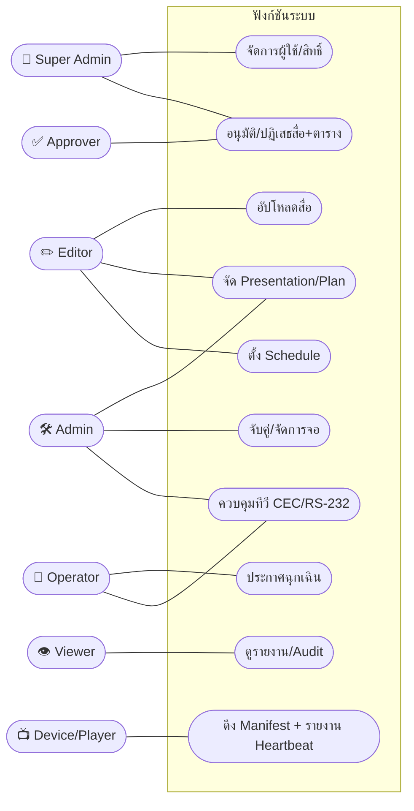
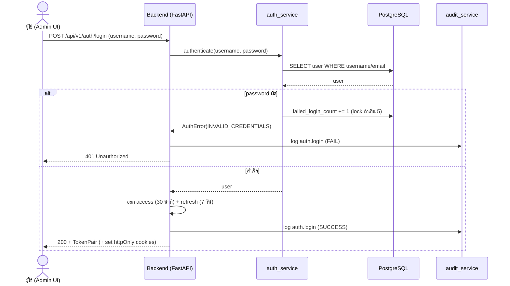
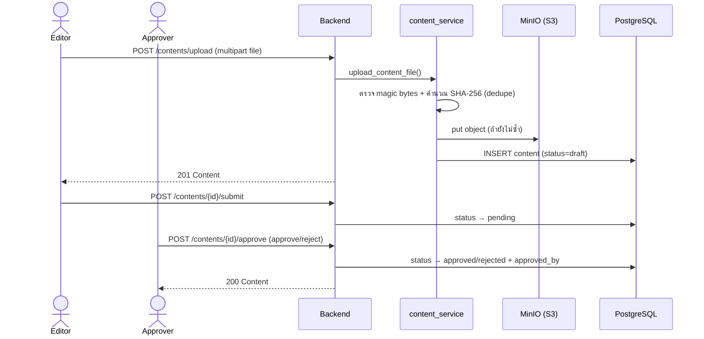
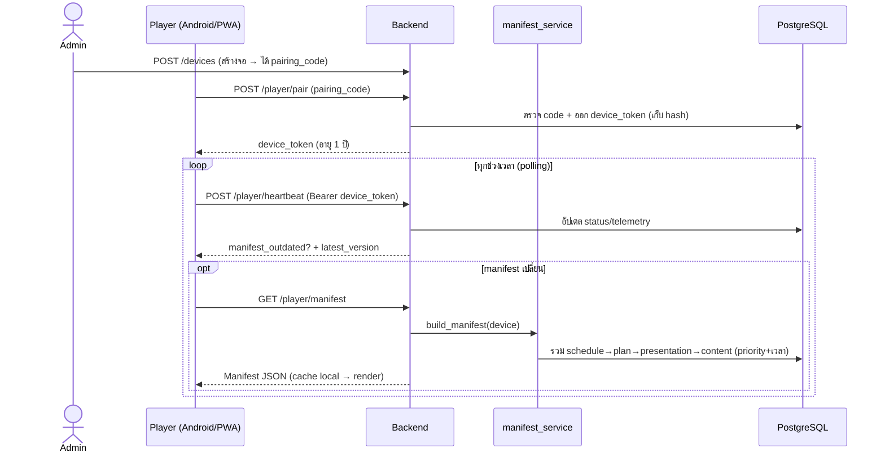
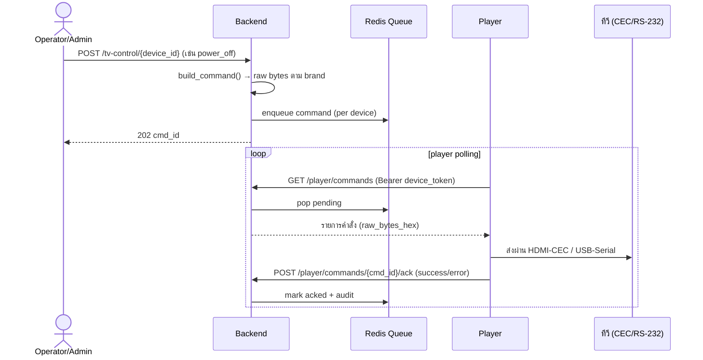
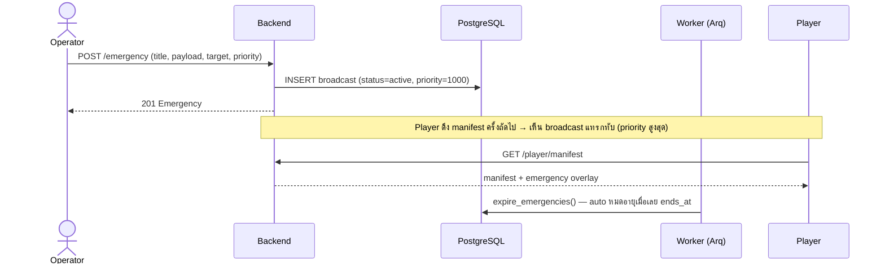

# 📊 Diagrams — Use-case & Sequence (สำหรับใส่เล่ม)

> Mermaid ทั้งหมด render ได้บน GitHub / VS Code / Obsidian — หากต้องการรูป PNG ใส่เล่ม ให้คัดลอกบล็อกไปวางที่ <https://mermaid.live> แล้ว export
> เสริมจาก [architecture.md](architecture.md) (สถาปัตยกรรม) และ [er-diagram.md](er-diagram.md) (ฐานข้อมูล)

---

## 1) Use-case Diagram (ภาพรวมผู้ใช้ ↔ ฟังก์ชัน)

แสดงว่าแต่ละบทบาท (RBAC 7 roles) ทำอะไรได้บ้าง

---

## 2) Sequence — Login + JWT (§26)

---

## 3) Sequence — อัปโหลด → อนุมัติสื่อ (§21–§22)

---

## 4) Sequence — จับคู่จอ + ดึง Manifest (§35.2)

---

## 5) Sequence — ควบคุมทีวีผ่าน Queue (§24)

---

## 6) Sequence — ประกาศฉุกเฉิน (§8.5)

---

**ดูเพิ่ม:** [report-guide.md](report-guide.md) (ข้อมูลทำเล่ม) · [api-reference.md](api-reference.md) · [data-dictionary.md](data-dictionary.md)
