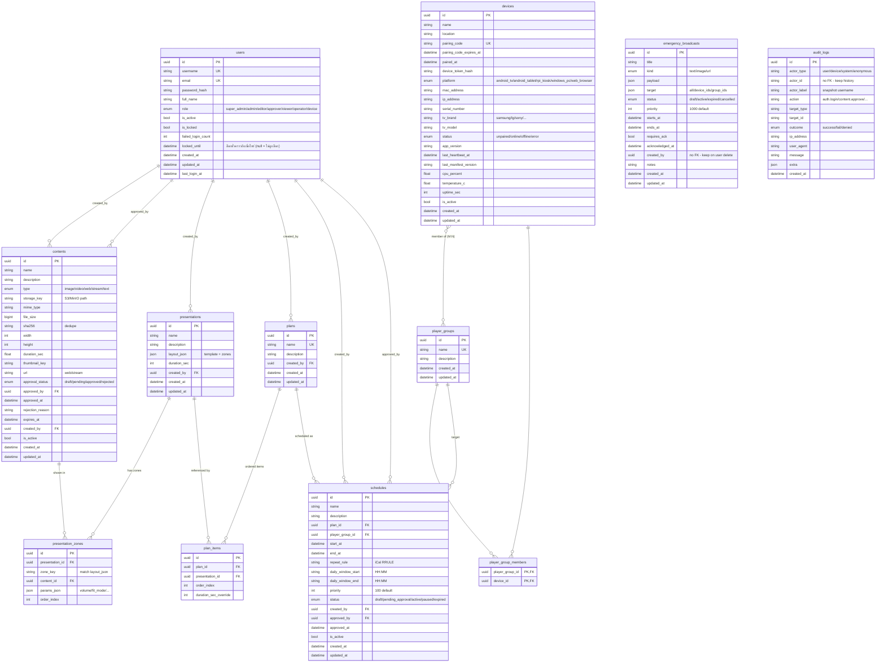
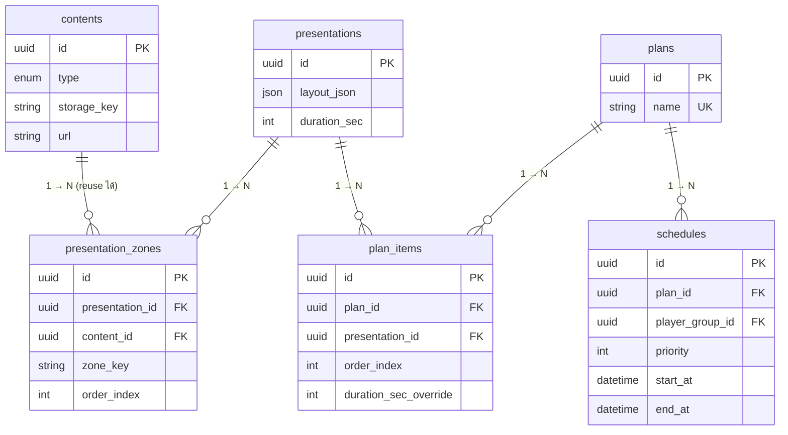
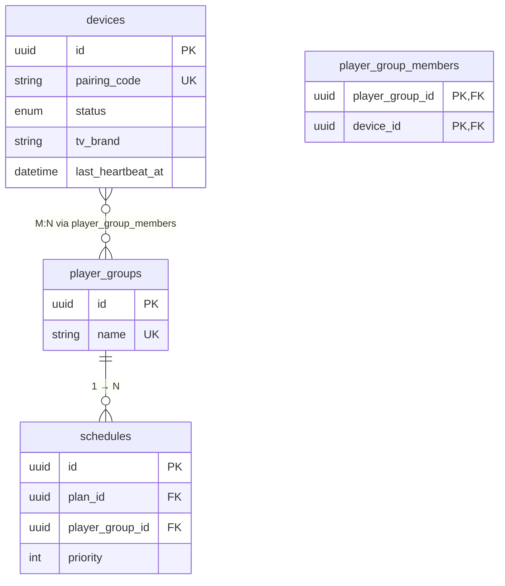
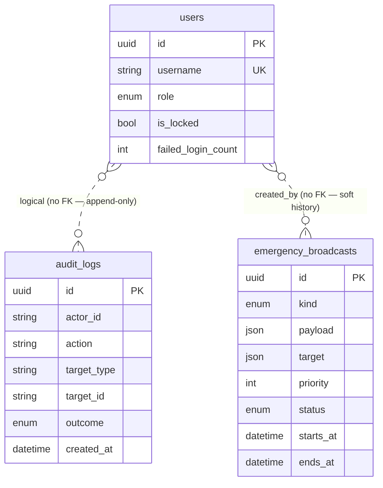

# 🗂️ ER Diagram — Digital Signage Management System

> **ที่มา:** สังเคราะห์จาก SQLAlchemy models ใน [`backend/app/models/`](../backend/app/models)
> **อัปเดต:** 2026-05-28 (Session #19 / scheduled run)
> **ครอบคลุม:** ตารางทั้งหมดที่มีในระบบหลัง Phase 0–5 (Auth / Devices / Contents / Presentation / Plan / Schedule / Emergency / Audit)
>
> ใช้ Mermaid `erDiagram` — GitHub / VS Code / Obsidian render ได้ทันที (ไม่ต้องลง plugin)
> หากต้องการ PNG: คัดลอกบล็อค Mermaid ไปใส่ <https://mermaid.live> แล้ว export

---

## 1) ภาพรวมระบบ (Bird's-eye view)

ระบบมี **8 entity หลัก + 1 association table (M:N)** แบ่งเป็น 5 กลุ่ม:

| กลุ่ม | Entities | บทบาท |
|---|---|---|
| 🔐 **Identity & Audit** | `users`, `audit_logs` | ผู้ใช้ระบบ + บันทึก action ทั้งหมด (append-only) |
| 📺 **Devices** | `devices`, `player_groups`, `player_group_members` | จอ + กลุ่มจอ (M:N) |
| 🎞️ **Content & Composition** | `contents`, `presentations`, `presentation_zones` | สื่อ raw + layout 5-tier (§35.1) |
| 📋 **Playlists & Schedules** | `plans`, `plan_items`, `schedules` | sequence ของ presentation + เวลาเล่น |
| 🚨 **Emergency** | `emergency_broadcasts` | override schedule (target เป็น JSON — ไม่มี FK) |

> หมายเหตุ ER diagram: `emergency_broadcasts.created_by` และ `audit_logs.actor_id` ไม่ได้กำหนด FK ฝั่ง DB
> (เก็บเป็น UUID/String เพื่อให้ user ถูกลบได้แต่ log ยังคงอยู่ — pattern audit trail)
> เลยใส่เป็นเส้นประ (logical link) ใน diagram

---

## 2) Mermaid ER Diagram — Full

---

## 3) Subgraph — Content Composition (5-Tier Hierarchy §35.1)

ระดับเริ่มจาก **content ดิบ → ประกอบเป็น zone → ใส่ใน presentation (layout) → เรียงใน plan → ผูกกับ schedule** เน้นให้ editor reuse content ได้

**Tier mapping (จาก §35.1):**
1. **Tier 1 — Content** (raw asset เดียว ใช้ได้หลายที่)
2. **Tier 2 — Zone** (1 zone = 1 content + params ใน layout)
3. **Tier 3 — Presentation** (layout + zones รวมกัน → 1 หน้าจอที่ compose แล้ว)
4. **Tier 4 — Plan** (sequence ของ presentation พร้อม override duration)
5. **Tier 5 — Schedule** (จับ plan กับ player_group + เวลา + priority)

---

## 4) Subgraph — Devices & Schedule Routing

**ทำไม schedule ผูกกับ `player_group` ไม่ใช่ `device` ตรง ๆ?**
- เปลี่ยน schedule ครั้งเดียวกระทบทั้งกลุ่ม (เช่น "จอชั้น 1 ทั้งหมด")
- เพิ่มจอเข้ากลุ่ม → ได้ schedule อัตโนมัติ ไม่ต้องแก้แต่ละจอ
- ถ้าต้องการ schedule เฉพาะจอ ให้สร้าง group ที่มี 1 device

---

## 5) Subgraph — Identity, Audit & Emergency

> เส้น `..` = logical link (ไม่มี FK constraint จริง) — ตั้งใจเพื่อให้ audit/emergency คงอยู่หาก user ถูกลบ ตาม §31 (PDPA retention)

---

## 6) Index ที่ต้องตรวจสอบ (สำคัญต่อ performance)

| ตาราง | คอลัมน์ | สาเหตุ |
|---|---|---|
| `users` | `username`, `email` | UNIQUE + login lookup |
| `devices` | `pairing_code` | UNIQUE + pair lookup |
| `devices` | `mac_address` | network identification |
| `contents` | `sha256` | dedupe lookup §22 |
| `contents` | `name` | admin list search |
| `schedules` | `start_at`, `end_at`, `priority`, `status` | manifest computation (filter by time + priority sort) |
| `schedules` | `plan_id`, `player_group_id` | join |
| `audit_logs` | `created_at`, `action`, `actor_id`, `target_id` | forensic query |
| `presentation_zones` | `presentation_id` | join load |
| `plan_items` | `plan_id` | join load |

> ทั้งหมดมีกำหนดไว้ใน model แล้ว (ตรวจสอบที่ `index=True` / `unique=True`) — Alembic generate auto

---

## 7) Cascade & Deletion Policy

| Relationship | ON DELETE | เหตุผล |
|---|---|---|
| `player_group_members` → `player_groups` / `devices` | **CASCADE** | join table → ลบได้เมื่อต้น/ปลายหาย |
| `presentation_zones` → `presentations` | **CASCADE** | zones ไม่มีความหมายถ้า presentation หาย |
| `plan_items` → `plans` | **CASCADE** | items ไม่มีความหมายถ้า plan หาย |
| `presentation_zones.content_id` → `contents` | **RESTRICT** (default) | ห้ามลบ content ถ้ายังถูกใช้ |
| `plan_items.presentation_id` → `presentations` | **RESTRICT** (default) | ห้ามลบ presentation ถ้ายังถูก plan ใช้ |
| `schedules.plan_id` / `player_group_id` | **RESTRICT** (default) | ห้ามลบของที่ยัง schedule อยู่ |
| `audit_logs`, `emergency_broadcasts` → `users` | **ไม่มี FK** | append-only — ลบ user แล้ว log ยังอยู่ |

> **Optional (รอ permission):** เปลี่ยนบาง RESTRICT เป็น `SET NULL` หรือ soft-delete pattern (`is_active=False`) — ขึ้นกับ business rule

---

## 8) Schema คงเหลือ (ที่ยังไม่มีใน DB, อยู่ใน PLAN.md)

| ตาราง | สถานะ | Phase ที่จะเพิ่ม |
|---|---|---|
| `device_telemetry_history` (time-series) | ⏸️ Pending | Phase 5 rest (เก็บ heartbeat history) |
| `tv_command_log` | ⏸️ Pending | Phase 4 (ปัจจุบันใช้ Redis queue + audit_log แทน) |
| `content_tags` / `tags` | ⏸️ Optional | Phase 6 (taxonomy) |
| `notification_preferences` | ⏸️ Optional | Phase 5 rest (Line/Telegram per-user) |
| `pdpa_consents` | ⏸️ Optional | Phase 6/7 (§31) |
| `device_logs` (player → server log forwarding) | ⏸️ Optional | Phase 5 rest |

---

## 9) วิธีอัปเดต ER diagram (เมื่อ schema เปลี่ยน)

1. แก้ model ใน `backend/app/models/*.py`
2. รัน `alembic revision --autogenerate -m "..."` → ได้ migration ใหม่
3. อัปเดต block Mermaid ในไฟล์นี้ให้ตรง field ที่เพิ่ม/ลด
4. commit คู่กับ migration (review เห็น diff schema + diagram พร้อมกัน)

---

**ดูเพิ่ม:**
- [PLAN.md §35.1 — 5-Tier Hierarchy](../PLAN.md)
- [docs/architecture.md](architecture.md)
- [backend/app/models/](../backend/app/models)
